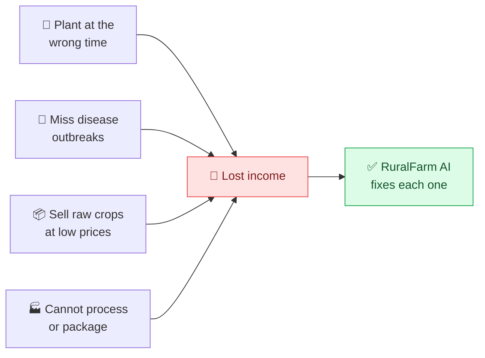
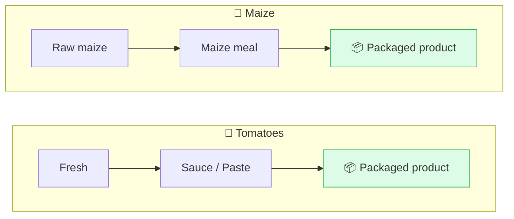
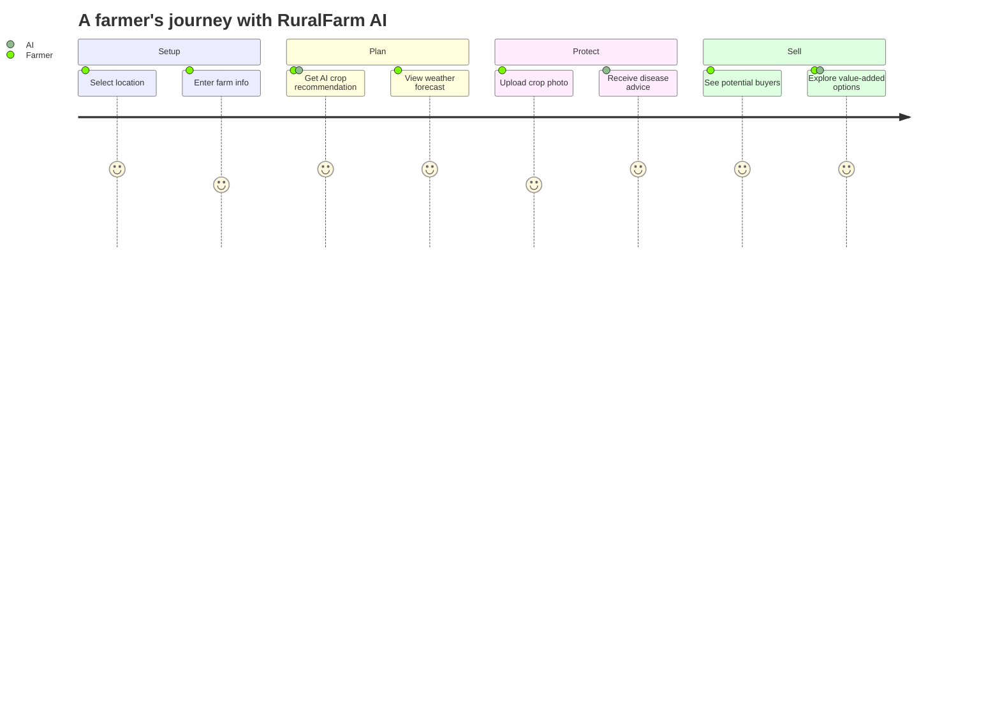
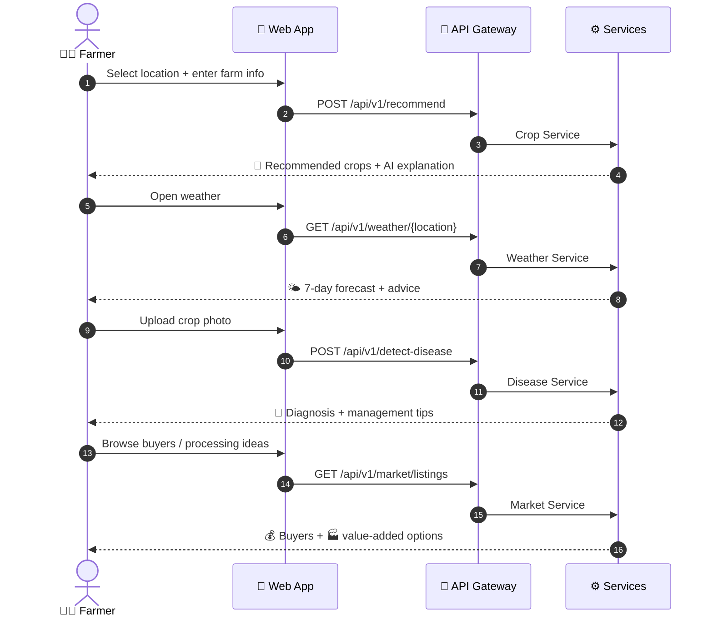
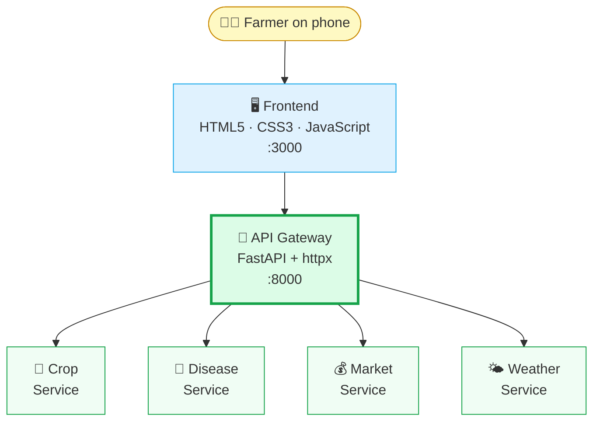
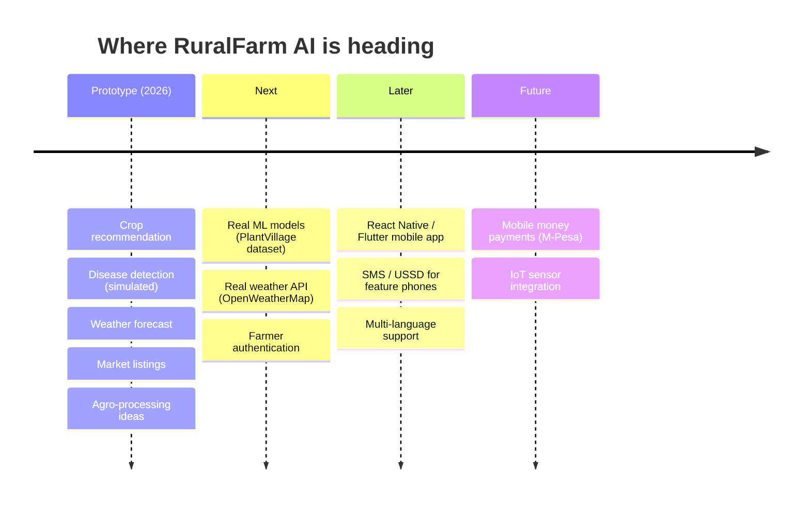

<div align="center">

<br/>


<h3>Smart Farming Solutions for Rural Farmers</h3>


<br/>


<br/><br/>

<a href="#-about-the-project">About</a> &nbsp;•&nbsp;
<a href="#-the-problem-we-solve">Problem</a> &nbsp;•&nbsp;
<a href="#-features">Features</a> &nbsp;•&nbsp;
<a href="#%EF%B8%8F-architecture">Architecture</a> &nbsp;•&nbsp;
<a href="#-quick-start">Quick Start</a> &nbsp;•&nbsp;
<a href="#-roadmap">Roadmap</a>


</div>

---

## 📖 About the Project

**RuralFarm AI** is an AI-powered platform that helps small-scale rural farmers make better decisions about:

| 🌾 What | ⏰ When | 🧑‍🌾 How | 💰 Where |
|:---:|:---:|:---:|:---:|
| to **plant** | to **plant** | to **manage crops** | and how to **sell produce** |

It brings **AI + Agriculture + Market Access + Agro-Processing** together in a practical, mobile-first platform that a rural farmer can use on any phone.

> 💡 *The knowledge of an agricultural expert, in every farmer's pocket.*

---

## 🏆 Hackathon Context

<div align="center">


</div>

<br/>

| Detail | Info |
|:--|:--|
| 🎪 **Event** | Sol Plaatje University Hackathon |
| 🏛️ **Hosted by** | MIH Seta (MICT SETA) |
| 📅 **Year** | 2026 |
| 🎯 **Theme** | Agriculture & Agro-Processing |
| 🔍 **Focus** | Practical, AI-powered solutions for rural farmers |

---

## 🎯 The Problem We Solve

Rural farmers often lack:

- ❌ Timely agricultural information
- ❌ Access to technology and AI tools
- ❌ Market access and fair pricing
- ❌ Opportunities to add value to their produce

They can lose **up to 70% of potential income** because they:



---

## 🚀 Features

<table>
  <tr>
    <td align="center" width="20%">
      <h3>🌾</h3>
      <b>Crop<br/>Recommendation</b>
    </td>
    <td align="center" width="20%">
      <h3>🔬</h3>
      <b>Disease<br/>Detection</b>
    </td>
    <td align="center" width="20%">
      <h3>🌤️</h3>
      <b>Weather<br/>Forecast</b>
    </td>
    <td align="center" width="20%">
      <h3>💰</h3>
      <b>Market<br/>Access</b>
    </td>
    <td align="center" width="20%">
      <h3>🏭</h3>
      <b>Agro-<br/>Processing</b>
    </td>
  </tr>
  <tr>
    <td valign="top">Enter location, soil type, water availability and season. Get the best crops to plant, with an AI explanation of why.</td>
    <td valign="top">Upload a photo of a crop or leaf. AI flags possible problems and suggests management advice.</td>
    <td valign="top">7-day forecasts with practical advice on planting and harvesting.</td>
    <td valign="top">View indicative market info and list produce for buyers and cooperatives.</td>
    <td valign="top">Value-added ideas so farmers think beyond selling raw crops.</td>
  </tr>
</table>

> ⚠️ Disease detection gives guidance only. It does not replace an agricultural expert.

### 🏭 Agro-Processing: Value Chain



---

## 🧪 Hackathon Demo Flow

A complete, working farmer journey, not 20 features that half work.





---

## 🏗️ Architecture

A **microservices architecture** built with **FastAPI (Python)** and a mobile-first web frontend.



---

## 🛠️ Tech Stack

| Layer | Technology |
|:--|:--|
| 🐍 **Backend** | FastAPI (Python) |
| 🎨 **Frontend** | HTML5, CSS3, JavaScript |
| 🚪 **API Gateway** | FastAPI + httpx |
| 🧩 **Architecture** | Microservices |
| 🤖 **AI** | Simulated (ready for TensorFlow / PyTorch) |

---

## 📦 Quick Start

**1️⃣ Install dependencies**
```powershell
pip install -r requirements.txt
```

**2️⃣ Start all services**
```powershell
.\run_all.ps1
```

**3️⃣ Open the app**

| What | URL |
|:--|:--|
| 🌐 Web app | http://127.0.0.1:3000 |
| 📚 API docs | http://127.0.0.1:8000/docs |

---

## 📊 API Endpoints

| Endpoint | Method | Description |
|:--|:--:|:--|
| `/api/v1/recommend` | `POST` | Get crop recommendations |
| `/api/v1/detect-disease` | `POST` | Upload crop photo for diagnosis |
| `/api/v1/weather/{location}` | `GET` | Get weather forecast |
| `/api/v1/market/listings` | `GET` | View market listings |
| `/api/v1/process-suggestion/{crop}` | `GET` | Get processing ideas |

---

## 📁 Project Structure

```text
ruralfarm-ai/
├── services/
│   ├── api-gateway/       # Single entry point
│   ├── crop-service/      # Crop recommendations
│   ├── disease-service/   # Disease detection
│   ├── market-service/    # Market listings & processing
│   └── weather-service/   # Weather forecasts
├── frontend/
│   └── web-app/           # Mobile-first web app
├── launch_scripts/
├── requirements.txt
└── README.md
```

---

## 🔮 Roadmap



- [ ] Real ML models for disease detection (PlantVillage dataset)
- [ ] Real weather API (OpenWeatherMap)
- [ ] User authentication for farmers
- [ ] React Native / Flutter mobile app
- [ ] SMS / USSD support for feature phones
- [ ] Multi-language support (English, Swahili, Hausa, and more)
- [ ] Payment integration (M-Pesa, mobile money)
- [ ] IoT sensor integration

---

## 👥 Team

<div align="center">

<a href="https://github.com/LuthandoCandlovu">
  
</a>

**Luthando Candlovu**
*Developer*

</div>

---

## 🙏 Acknowledgements

- 🎓 **Sol Plaatje University** for hosting the hackathon
- 🏛️ **MIH Seta (MICT SETA)** for sponsoring and supporting the event
- 🤝 All mentors, judges and fellow participants

---

## 📄 License

Released under the **MIT License**.

<div align="center">

<br/>

**Built with ❤️ for farmers everywhere 🌱**


</div>
